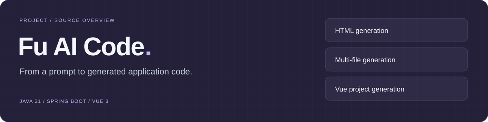
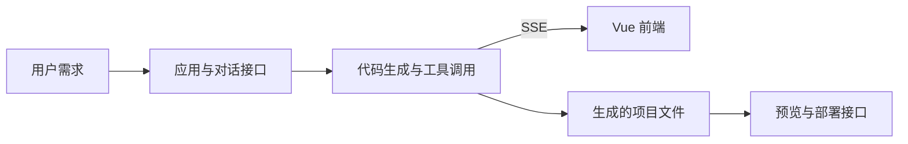

# Fu AI Code



**AI 应用代码生成实验：HTML、多文件与 Vue 项目，支持流式输出。**

[生成接口](src/main/java/com/dali/fuaicode/ai/AiCodeGeneratorService.java) · [应用接口](src/main/java/com/dali/fuaicode/controller/AppController.java) · [前端](fufu-ai-code-frontend/) · [建表脚本](create_table.sql)

## 核心流程



## 模块导航

| 模块 | 内容 | 入口 |
| --- | --- | --- |
| 代码生成 | HTML、多文件、Vue 项目与流式输出 | [AiCodeGeneratorService](src/main/java/com/dali/fuaicode/ai/AiCodeGeneratorService.java) |
| 工作流 | 生成流程与工具编排 | [CodeGenWorkflow](src/main/java/com/dali/fuaicode/langgraph4j/CodeGenWorkflow.java) |
| 应用管理 | 应用信息、生成请求、部署与下载 | [AppController](src/main/java/com/dali/fuaicode/controller/AppController.java) |
| 用户 | 注册、登录与管理接口 | [UserController](src/main/java/com/dali/fuaicode/controller/UserController.java) |
| 对话历史 | 会话记录接口 | [ChatHistoryController](src/main/java/com/dali/fuaicode/controller/ChatHistoryController.java) |
| 前端请求 | Axios、登录态与 API 基址 | [request.ts](fufu-ai-code-frontend/src/request.ts) |

## 技术栈

Java 21、Spring Boot 3、LangChain4j、LangGraph4j、MyBatis-Flex、MySQL、Redis；前端使用 Vue 3、TypeScript、Vite 与 Ant Design Vue。完整依赖以 [pom.xml](pom.xml) 和 [package.json](fufu-ai-code-frontend/package.json) 为准。

## 本地运行

先准备 Java 21、Maven、Node.js、MySQL 和 Redis。数据库表结构见 [create_table.sql](create_table.sql)。模型服务与外部素材工具需要配置对应凭据；把凭据留在本机环境变量或私有配置中。

在仓库根目录启动后端：

```bash
./mvnw spring-boot:run
```

另开终端启动前端：

```bash
cd fufu-ai-code-frontend
npm install
npm run dev
```

后端端口与 context path 由本机配置决定。前端请求层使用 [src/config/env.ts](fufu-ai-code-frontend/src/config/env.ts) 导出的 `API_BASE_URL`，运行前核对两端地址。

## 开发与阅读

- `./mvnw test`：后端测试，需要满足相关测试的服务与配置依赖。
- 前端目录中的 `npm run build`：生产构建；其余命令见 package.json。
- 模型接入：[模型配置类](src/main/java/com/dali/fuaicode/config/)。
- 外部素材工具：[工作流工具](src/main/java/com/dali/fuaicode/langgraph4j/tools/)。

